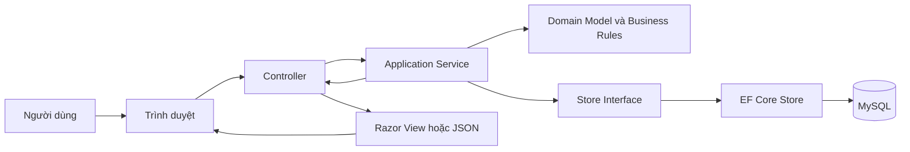
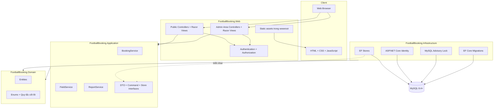
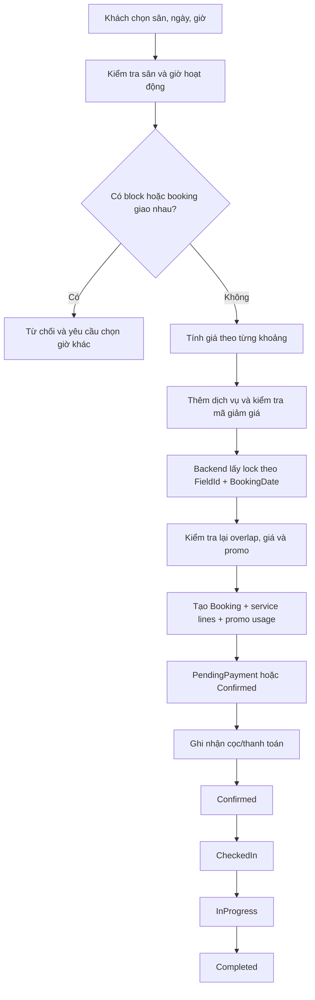
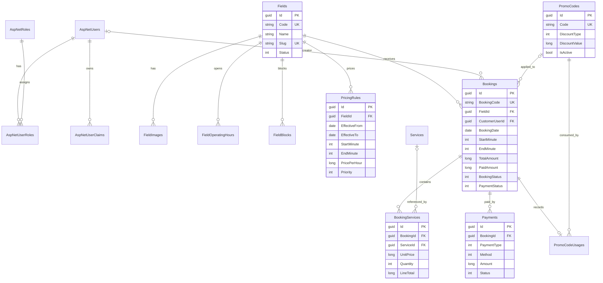

# FootballBooking — Tài liệu review demo

> Tài liệu tóm tắt phục vụ trình bày dự án. Hiện trạng được đối chiếu theo source code và migration MySQL ngày **04/11/2026**.

## 1. Tổng quan dự án

**FootballBooking** là hệ thống web quản lý và đặt sân bóng mini, gồm:

- Website công khai cho khách xem sân, kiểm tra lịch trống, đặt sân và tra cứu booking.
- Tài khoản khách hàng để quản lý thông tin và lịch sử đặt sân.
- Khu vực Admin cho nhân viên/chủ sân quản lý lịch, booking, thanh toán, danh mục và báo cáo.

**Kiến trúc:** ASP.NET Core MVC theo hướng **modular monolith phân tầng**.  
**Backend:** .NET 10, C#, ASP.NET Core MVC, Entity Framework Core 10, Identity.  
**Frontend:** Razor Views, Tailwind CSS, Preline UI, JavaScript, FullCalendar, Chart.js.  
**Database:** MySQL 8.4+, EF Core Migrations.

---

## 2. Mô hình MVC trong hệ thống

| Thành phần | Hiện thực trong dự án | Trách nhiệm |
|---|---|---|
| **Model** | Domain entities/enums, Application DTO/command, ViewModel | Biểu diễn dữ liệu và quy tắc nghiệp vụ |
| **View** | Razor `.cshtml` trong `Views` và `Areas/Admin/Views` | Render HTML phía server và hiển thị dữ liệu |
| **Controller** | Controller công khai và Admin Area Controller | Nhận HTTP request, model binding, kiểm tra đầu vào, gọi Application Service và trả View/JSON/redirect |

Controller không truy vấn database trực tiếp trong luồng nghiệp vụ chính. Logic đặt sân, tính giá, khuyến mãi, thanh toán và trạng thái được điều phối ở tầng **Application**; tầng **Infrastructure** đảm nhiệm EF Core/MySQL và Identity.



---

## 3. Sơ đồ kiến trúc tổng thể



### Quy tắc phụ thuộc

```text
Web ───────────────► Application
Web ───────────────► Infrastructure (đăng ký DI/Identity tại composition root)
Application ───────► Domain
Infrastructure ────► Application + Domain
Domain ────────────► không phụ thuộc Web, EF Core hoặc MySQL
```

---

## 4. Mục đích các thư mục chính

| Thư mục/file | Mục đích |
|---|---|
| `src/FootballBooking.Web/` | Tầng trình bày: Controller, Razor View, ViewModel, Admin Area, static assets và `Program.cs` |
| `src/FootballBooking.Web/Controllers/` | Các endpoint công khai: trang chủ, sân, đặt sân, tài khoản, dịch vụ, khuyến mãi, tra cứu |
| `src/FootballBooking.Web/Areas/Admin/` | Khu vực nội bộ: dashboard, lịch, booking, thanh toán, sân, dịch vụ, khuyến mãi, báo cáo, nhân viên |
| `src/FootballBooking.Web/Views/` | Giao diện Razor cho khách hàng |
| `src/FootballBooking.Web/wwwroot/` | CSS, JavaScript, hình ảnh đã build và được ASP.NET Core phục vụ trực tiếp |
| `src/FootballBooking.Application/` | Use case, Application Service, DTO, command và interface hạ tầng |
| `src/FootballBooking.Application/Bookings/` | Đặt sân, kiểm tra lịch, tính giá, promo, payment và chuyển trạng thái |
| `src/FootballBooking.Application/Fields/` | Tra cứu và quản lý sân, giờ hoạt động, khóa sân, bảng giá |
| `src/FootballBooking.Application/Reports/` | Dashboard, thống kê và xuất CSV |
| `src/FootballBooking.Domain/` | Entity, enum và dữ liệu nghiệp vụ cốt lõi, không phụ thuộc framework web/database |
| `src/FootballBooking.Infrastructure/` | EF Core, MySQL, Identity, store/repository, migration, seeder, clock và booking lock |
| `src/FootballBooking.Infrastructure/Data/` | `ApplicationDbContext`, cấu hình entity, converter và cấu hình database |
| `src/FootballBooking.Infrastructure/Migrations/` | Lịch sử tạo/cập nhật schema MySQL |
| `tests/FootballBooking.Tests/` | Unit test và integration test cho nghiệp vụ, route, persistence và Identity |
| `docs/` | Tài liệu phân tích, kiến trúc, database, nghiệp vụ và kiểm thử chi tiết |
| `package.json` | Script build/watch Tailwind CSS và JavaScript bằng npm/esbuild |
| `FootballBooking.slnx` | Solution liên kết các project .NET |

---

## 5. Luồng xử lý hệ thống

### 5.1. Luồng HTTP MVC chung

```text
Browser gửi request
→ ASP.NET Core Routing
→ Authentication/Authorization
→ Controller nhận và kiểm tra dữ liệu
→ Application Service thực hiện use case
→ Store interface gọi EF Core implementation
→ EF Core đọc/ghi MySQL
→ Service trả DTO/kết quả
→ Controller tạo ViewModel
→ Razor View render HTML (hoặc API trả JSON)
→ Browser hiển thị kết quả
```

### 5.2. Luồng đặt sân



MySQL advisory lock phối hợp các request đồng thời, kể cả khi chạy nhiều web instance, nhằm hạn chế hai người cùng giữ một sân trong cùng thời điểm.

### 5.3. Luồng tra cứu booking công khai

```text
Nhập BookingCode + số điện thoại
→ Backend chuẩn hóa số điện thoại
→ So khớp cả mã booking và số điện thoại
→ Chỉ trả thông tin booking phù hợp
```

### 5.4. Luồng frontend

Razor render HTML phía server. Các file đã build nằm trong `wwwroot`, nên ứng dụng vẫn hiển thị giao diện khi không chạy `npm run dev`. Lệnh này chỉ theo dõi và build lại CSS/JavaScript khi lập trình viên sửa source frontend.

---

## 6. Chức năng chính

### Khách/khách hàng

- Đăng ký, đăng nhập và quản lý tài khoản khách hàng.
- Xem danh sách và chi tiết sân.
- Kiểm tra lịch trống theo ngày/khung giờ.
- Đặt sân có hoặc không có tài khoản.
- Chọn dịch vụ đi kèm và phương thức thanh toán.
- Áp dụng mã khuyến mãi.
- Nhận mã, tra cứu và hủy booking theo chính sách.
- Xem lịch sử booking khi đăng nhập.

### Nhân viên/chủ sân

- Đăng nhập khu vực nội bộ.
- Xem dashboard và lịch sân bằng FullCalendar.
- Lọc lịch theo sân, ngày và trạng thái.
- Tạo booking tại quầy/qua điện thoại.
- Ghi nhận thanh toán, check-in, bắt đầu và hoàn thành lượt chơi.
- Xử lý booking hủy, hết hạn hoặc khách không đến.
- Quản lý sân, giờ mở cửa, thời gian khóa sân và bảng giá.
- Quản lý dịch vụ, khuyến mãi.
- Xem thống kê doanh thu, công suất sân và xuất CSV.
- Owner quản lý tài khoản, quyền và bảng lương nhân viên.

---

## 7. Nghiệp vụ quan trọng

1. **Sân khả dụng:** sân phải hoạt động; booking nằm trong giờ mở cửa; không giao `FieldBlock` hoặc booking đang chiếm lịch.
2. **Khoảng giờ hợp lệ:** `0 ≤ StartMinute < EndMinute ≤ 1440`, đủ thời lượng tối thiểu và đúng bước slot của sân.
3. **Chống trùng:** hai khoảng giao nhau khi `newStart < existingEnd && newEnd > existingStart`. Hai booking sát nhau, ví dụ `17:00–18:00` và `18:00–19:00`, vẫn hợp lệ.
4. **Giữ chỗ:** booking online có thể ở `PendingPayment` và chỉ chiếm lịch đến `ExpiresAtUtc`; hold hết hạn không tiếp tục giữ sân.
5. **Tính giá:** backend chia booking thành các đoạn theo bảng giá rồi cộng tiền từng đoạn; không nhận tổng tiền do client tự gửi.
6. **Dịch vụ:** lưu snapshot tên, đơn giá, đơn vị và số lượng để thay đổi giá mới không ảnh hưởng booking cũ.
7. **Khuyến mãi:** kiểm tra thời gian hiệu lực, đơn tối thiểu, giới hạn lượt dùng, số điện thoại và sân/khung giờ áp dụng; mỗi booking tối đa một mã.
8. **Trạng thái booking và thanh toán độc lập:** booking có thể đã xác nhận nhưng mới thanh toán một phần hoặc đã hoàn thành nhưng còn công nợ.
9. **Chuyển trạng thái chính:** `PendingPayment → Confirmed → CheckedIn → InProgress → Completed`; các nhánh khác gồm `Cancelled`, `Expired`, `NoShow`.
10. **Thanh toán:** chỉ giao dịch `Succeeded` được tính vào tiền đã trả/hoàn; hoàn tiền phải có payment record riêng.
11. **Booking khách:** lưu snapshot tên, điện thoại, email; booking guest không tự tạo tài khoản.
12. **Không xóa cứng lịch sử:** sân/dịch vụ ngừng dùng được chuyển trạng thái, tránh làm mất booking và giao dịch cũ.

---

## 8. Có bao nhiêu đối tượng?

### 8.1. Tác nhân sử dụng: **4**

| Tác nhân | Mô tả |
|---|---|
| **Guest** | Chưa đăng nhập; xem sân, tạo và tra cứu booking bằng mã + số điện thoại |
| **Customer** | Khách có tài khoản; có thêm hồ sơ và lịch sử booking |
| **Staff** | Nhân viên nội bộ; quyền được cấp theo từng nhóm công việc |
| **Owner** | Chủ sân; có toàn quyền vận hành và quản trị nhân viên |

> Hệ thống có **3 role Identity**: `Customer`, `Staff`, `Owner`. `Guest` không phải role và không có bản ghi tài khoản.

### 8.2. Đối tượng dữ liệu chính: **12**

1. `ApplicationUser`
2. `Field`
3. `FieldImage`
4. `FieldOperatingHour`
5. `FieldBlock`
6. `PricingRule`
7. `Booking`
8. `ServiceItem`
9. `BookingServiceLine`
10. `PaymentRecord`
11. `PromoCode`
12. `PromoCodeUsage`

### 8.3. Số bảng vật lý

- **11 bảng nghiệp vụ**.
- **7 bảng ASP.NET Core Identity**.
- Tổng cộng **18 bảng dữ liệu ứng dụng**.
- **19 bảng** nếu tính thêm bảng kỹ thuật `__EFMigrationsHistory`.

---

## 9. Phân quyền

Hệ thống kết hợp **Role-Based Access Control** và **permission claim**:

- Role xác định nhóm người dùng: Customer, Staff, Owner.
- Staff có thể được cấp 4 permission: `schedule.manage`, `payments.manage`, `catalog.manage`, `reports.view`.
- Staff chưa có claim tùy chỉnh mặc định được quản lý lịch/booking và thanh toán.
- Owner tự động có toàn bộ permission.

| Chức năng | Guest | Customer | Staff | Owner |
|---|:---:|:---:|:---:|:---:|
| Xem sân/dịch vụ/khuyến mãi | ✓ | ✓ | ✓ | ✓ |
| Tạo và tra cứu booking công khai | ✓ | ✓ | ✓ | ✓ |
| Hồ sơ và lịch sử cá nhân | — | ✓ | — | — |
| Dashboard nội bộ | — | — | ✓ | ✓ |
| Lịch và điều phối booking | — | — | Theo `schedule.manage` | ✓ |
| Ghi nhận thanh toán | — | — | Theo `payments.manage` | ✓ |
| Quản lý sân/dịch vụ/khuyến mãi | — | — | Theo `catalog.manage` | ✓ |
| Xem/xuất báo cáo | — | — | Theo `reports.view` | ✓ |
| Quản lý nhân viên và bảng lương | — | — | — | ✓ |

Các policy chính trong ứng dụng: `InternalUser`, `OwnerOnly`, `CanManageSchedule`, `CanManagePayments`, `CanAccessBookings`, `CanManageCatalog`, `CanViewReports`.

---

## 10. Phác thảo database



### Nhóm bảng thực tế

| Nhóm | Các bảng |
|---|---|
| Sân và giá | `Fields`, `FieldImages`, `FieldOperatingHours`, `FieldBlocks`, `PricingRules` |
| Booking và thanh toán | `Bookings`, `BookingServices`, `Payments` |
| Dịch vụ và khuyến mãi | `Services`, `PromoCodes`, `PromoCodeUsages` |
| Identity | `AspNetUsers`, `AspNetRoles`, `AspNetUserRoles`, `AspNetUserClaims`, `AspNetRoleClaims`, `AspNetUserLogins`, `AspNetUserTokens` |
| EF metadata | `__EFMigrationsHistory` |

---

## 11. Kịch bản demo đề xuất

1. Giới thiệu bài toán, 4 tác nhân và kiến trúc MVC phân tầng.
2. Mở trang danh sách/chi tiết sân và kiểm tra lịch trống.
3. Tạo một booking kèm dịch vụ/khuyến mãi; lưu lại booking code.
4. Tra cứu booking bằng code + số điện thoại.
5. Đăng nhập Admin, mở lịch FullCalendar và tìm booking vừa tạo.
6. Ghi nhận cọc/thanh toán, sau đó chạy luồng `Confirmed → CheckedIn → InProgress → Completed`.
7. Mở quản lý sân/dịch vụ/khuyến mãi và giải thích permission Staff.
8. Mở dashboard/báo cáo và xuất CSV.
9. Kết thúc bằng database, quy tắc chống trùng và MySQL advisory lock.

## 12. Điểm nhấn khi trả lời giảng viên

- Đây là **MVC server-rendered**, không phải SPA; frontend và backend cùng chạy trong ASP.NET Core.
- MVC được mở rộng bằng kiến trúc phân tầng để Controller mỏng và nghiệp vụ dễ kiểm thử.
- Booking được kiểm tra lại ở backend; UI không phải nguồn sự thật.
- Chống trùng gồm kiểm tra overlap và lock tại database, không chỉ kiểm tra trên giao diện.
- Dữ liệu giá/dịch vụ/khách được snapshot để bảo toàn lịch sử.
- Booking status và payment status tách riêng để phản ánh đúng vận hành thực tế.
- Phân quyền không chỉ dựa vào role mà còn có permission claim chi tiết cho Staff.
